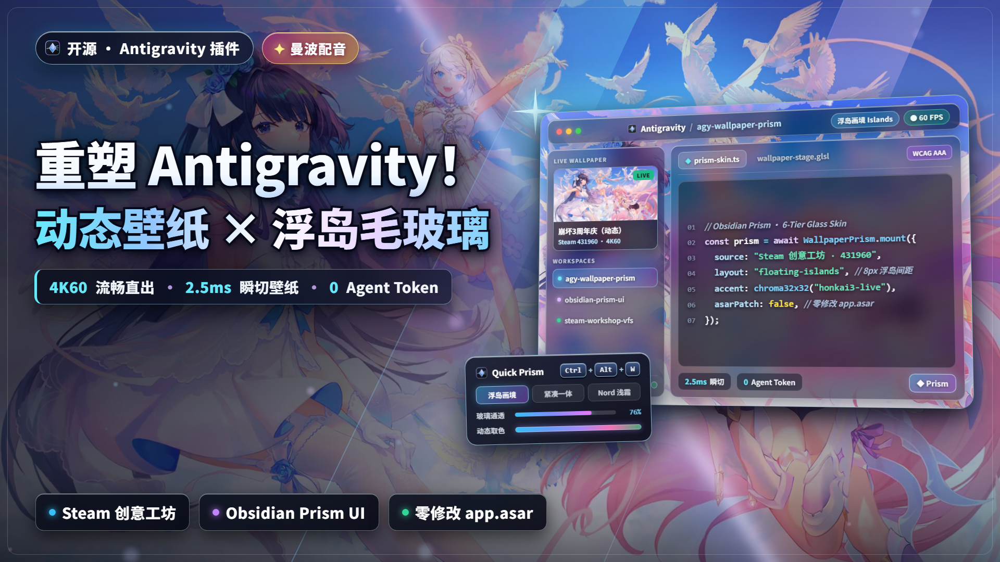
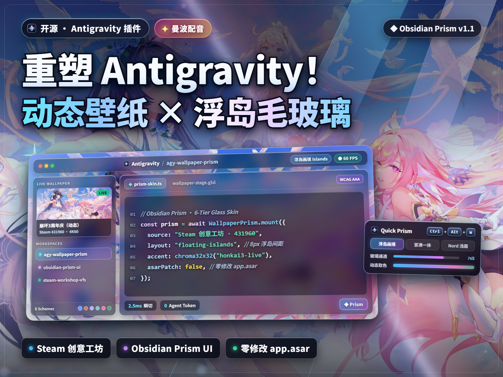

# Wallpaper Prism · Bilibili Promo Studio (`agy-wallpaper-prism-intro`)

> **Plugin Repository**: [https://github.com/azwosile/agy-wallpaper-prism](https://github.com/azwosile/agy-wallpaper-prism)  
> **Release Video & Assets**: [Releases · `v1.0.0`](https://github.com/azwosile/agy-wallpaper-prism-intro/releases/tag/v1.0.0)  
> **Target Version**: `Wallpaper Prism v1.1.0` for Google Antigravity

Reproducible WebGL2 optical motion studio, Mambo (`曼波`) TTS narration pipeline, Bilibili 16:9 / 4:3 covers, and full publishing kit for **`agy-wallpaper-prism`**.

---

## Preview · 封面预览

| Bilibili 16:9 首页封面 (`1920×1080`) | Bilibili 4:3 动态 / 经典封面 (`1600×1200`) |
| :---: | :---: |
|  |  |

---

## Final Release Video · 成品视频下载

Because the high-bitrate `1080p` master MP4 exceeds standard Git blob best practices, it is distributed via **GitHub Releases**:

- **Download `agy-wallpaper-prism-intro.mp4` (`v1.0.0`)**: [https://github.com/azwosile/agy-wallpaper-prism-intro/releases/tag/v1.0.0](https://github.com/azwosile/agy-wallpaper-prism-intro/releases/tag/v1.0.0)
- **Verified Master Specs**: `1920×1080 @ 60fps` (`5,628` frames, `93.80s`) · `H.264 High@4.2 (yuv420p, bt709, +faststart)` · `AAC-LC 48kHz Stereo 194kbps (-13.9 LUFS / -2.1 dBFS True Peak)` · `97.25 MB`

---

## Repository Structure · 目录结构

```text
agy-wallpaper-prism-intro/
├── assets/
│   └── showcase/
│       ├── library.json              # Sanitized SFW showcase wallpaper catalog
│       └── showcase-server.mjs       # Local mock Antigravity Hub + Studio HTTP server
├── audio/
│   ├── timeline.json                 # Frame-accurate narration & subtitle cue timeline
│   └── bgm-energy.json               # Pre-computed BGM energy curve for WebGL2 reactivity
├── covers/
│   ├── cover-16x9.png                # 1920×1080 Bilibili widescreen cover
│   └── cover-4x3.png                 # 1600×1200 Bilibili 4:3 dedicated composition cover
├── docs/
│   ├── narration-script.json         # Mambo (曼波) Chinese narration script & scene cues
│   ├── storyboard.md                 # Shot-by-shot camera, optics & UI choreography plan
│   └── bilibili-publish-guide.md     # Bilibili title, tags, description, chapters & upload checklist
├── scene/                            # Deterministic WebGL2 + HTML/CSS 1080p motion stage
├── scripts/
│   ├── prepare-assets.mjs            # Extracts sanitized showcase video frames & thumbnails
│   ├── generate-tts.mjs              # Fish Audio TTS synthesizer (reads FISH_API_KEY env var)
│   ├── mix-audio.mjs                 # FFmpeg voiceover + sidechain-ducked BGM (-14 LUFS)
│   ├── render-covers.mjs             # Headless Chromium renderer for 16:9 and 4:3 covers
│   ├── render-video.mjs              # Deterministic frame-by-frame Chromium -> FFmpeg H.264 renderer
│   └── publish-release.mjs           # GitHub Releases API uploader for MP4 & cover assets
├── package.json
└── README.md
```

---

## Reproduce Locally · 本地复现流程

### Prerequisites
- **Node.js** `>= 22.0.0` (zero external `npm` dependencies required for core scripts)
- **FFmpeg / FFprobe** on `PATH`
- **Google Chrome** or **Microsoft Edge** (used in headless CDP mode)
- Sibling repository `../agy-wallpaper-prism` built via `node scripts/build.mjs`

### Pipeline Commands

```powershell
# 1. Prepare sanitized showcase frames & thumbnails
npm run assets:prepare

# 2. Synthesize Mambo TTS narration (supply your own Fish Audio API key via environment variable)
$env:FISH_API_KEY = "<your-fish-audio-api-key>"
npm run tts:generate

# 3. Mix voiceover + BGM with sidechain ducking mastered to -14 LUFS
npm run audio:mix

# 4. Render 16:9 and 4:3 Bilibili PNG covers
npm run covers:render

# 5. Render final 1920x1080 H.264 + AAC MP4 into out/agy-wallpaper-prism-intro.mp4
npm run video:render

# 6. Upload out/agy-wallpaper-prism-intro.mp4 + covers to GitHub Release v1.0.0
npm run release:publish
```

---

## Security & Privacy · 安全与隐私声明

- **Zero Hardcoded Secrets**: `scripts/generate-tts.mjs` reads `process.env.FISH_API_KEY` at runtime only; no API keys or tokens are stored anywhere in this repository.
- **Sanitized Showcase Environment**: All UI captures use an isolated mock server (`assets/showcase/showcase-server.mjs`) with generic display paths (`~/Pictures/wallpapers`, `~/.agy-wallpaper-prism`) and strictly SFW (`everyone`-rated) wallpaper entries.
- **Bilibili Publishing Kit**: See [docs/bilibili-publish-guide.md](docs/bilibili-publish-guide.md) for titles, tags, chapter timestamps, and upload specs.
